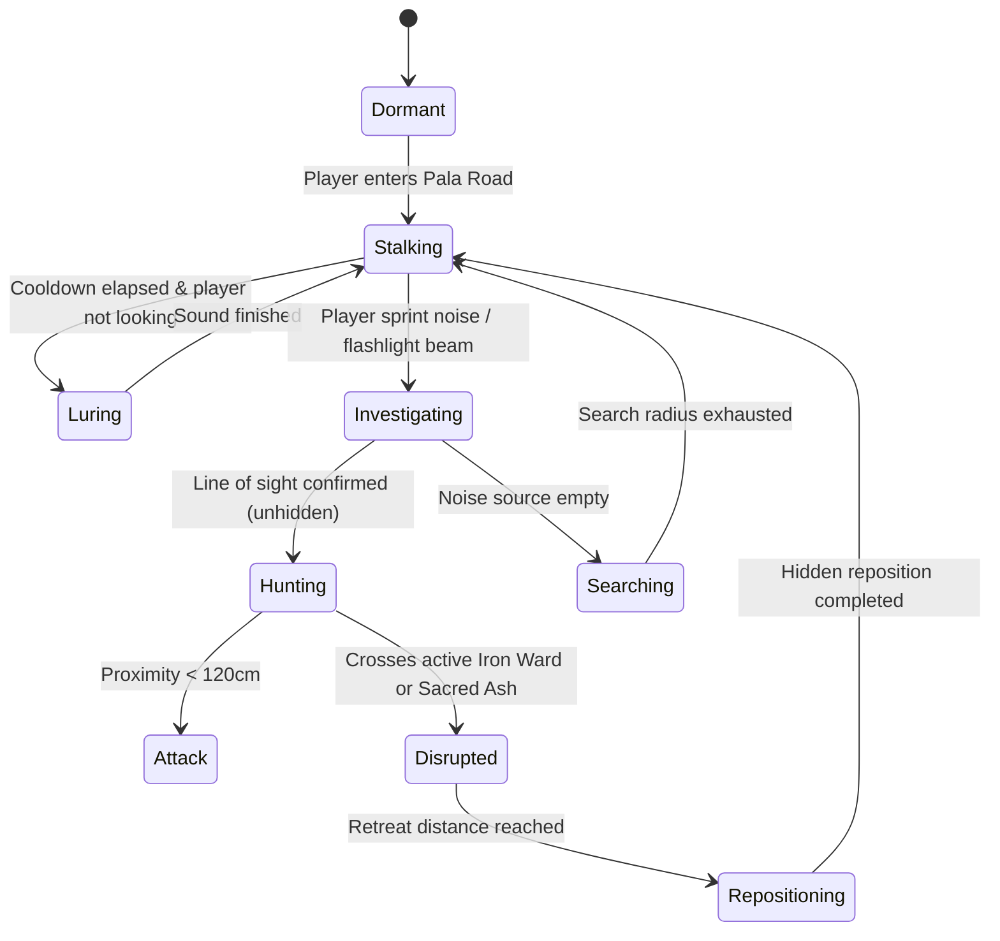

# Yakshi AI Behavior Tree & 9-State Design Specification

---

## 1. Overview
The Yakshi is an original Kerala folklore horror antagonist. Rather than a standard "zombie rusher", her behavior revolves around stealth, psychological isolation, deceptive spatial acoustics, and boundary deterrence.

---

## 2. The 9 AI States
1. **STATE 1 — DORMANT**:
   - Mesh hidden. No active footstep or breathing audio. Used at level intro to build environmental suspense.
2. **STATE 2 — STALKING**:
   - Navigates at flank/rear (1400–1800 units away). Moves only behind trees and obstacles when player looks away.
3. **STATE 3 — LURING**:
   - Emits spatialized voice calls in Malayalam ("Evideya...?", "Ente koode vaa...") and anklet chimes from misleading angles.
4. **STATE 4 — INVESTIGATING**:
   - Triggered by loud footsteps (sprinting), open doors, or thrown brass vessels. Moves cautiously to source.
5. **STATE 5 — HUNTING**:
   - Full-speed chase (540 cm/s) with line of sight. Hair flutters, atmospheric drone rises to peak intensity.
6. **STATE 6 — ATTACK**:
   - Proximity trigger within 1.2m outside ward zones. Plays attack stinger, grab animation, transitions to death screen.
7. **STATE 7 — DISRUPTED**:
   - Triggered when touching active Iron Ward barrier or Sacred Ash circle. Screams and sprints in opposite direction (680 cm/s).
8. **STATE 8 — SEARCHING**:
   - If player crouches or hides in closet/veranda shadow, Yakshi searches last known radius before breaking off.
9. **STATE 9 — REPOSITIONING**:
   - Fair relocation out of player field-of-view to prepare the next encounter.

---

## 3. Fairness Rules Implementation
- **Sight Checks**: Player visibility modified by crouching (`0.45x`), hiding spots (`0.05x`), and flashlight (`2.2x`).
- **No Instant Teleportation**: All transitions are bounded to NavMesh navigation.
- **Auditory Telegraphs**: Anklet bells always trigger within 25m, giving attentive players time to hide or prepare sacred ash.
